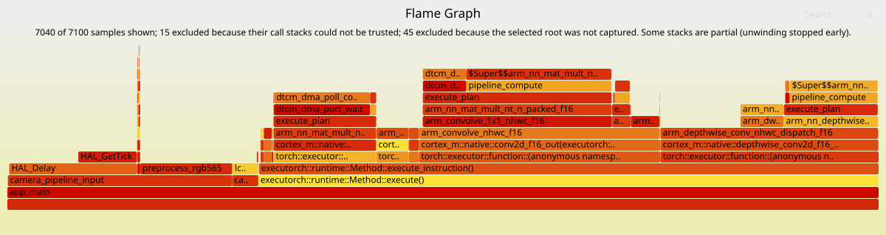
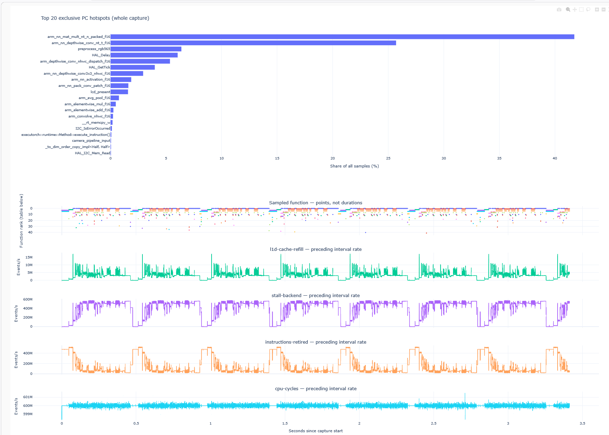

# Host tools and report interpretation

Run commands from the repository root. Keep raw allocations, the exact unstripped
ELF/AXF and the matching profiler revision. See [integration](INTEGRATION.md) for
first capture and [repeated captures](REPEATED_CAPTURES.md) for aggregation.

## Python and dependencies

Use Python 3.10+. Decoding, ELF preflight, packaging, index generation and
Perfetto export require only the standard library.

| Optional feature | Requirement |
|---|---|
| Interactive dashboard | Plotly: [requirements-visualization.txt](../host/requirements-visualization.txt) |
| Fold/joint CLI charts | Matplotlib, including NumPy; analysis helpers use only the standard library |
| Operator SVG charts | Standard library |
| PTE unwrapping | Matching model-build Vela environment: [operator inputs](ETHOSU_OPERATOR_REPORTS.md#inputs) |
| FlameGraph | Perl and Brendan Gregg's external `FlameGraph/flamegraph.pl` |
| Instruction/source annotation | GNU Arm/LLVM `objdump`; debug information, matching sources and `addr2line` for `--source` |
| C++ demangling | GNU/LLVM `c++filt` on PATH or `--cxxfilt PATH` |
| Python formatting | Ruff, development only |

```sh
python3 -m venv .venv
. .venv/bin/activate
python -m pip install -r host/requirements-visualization.txt  # optional dashboard
python -m pip install matplotlib                           # optional fold charts
```

## Decode and package a single capture

After preflight, capture, stop and full-allocation export, package into a new directory:

```sh
python3 host/create_profiler_report.py \
  --samples samples.bin --elf firmware.elf --output report \
  --board "<actual board or simulator>" --application "<application name>"
```

This writes `REPORT.md`, offline `index.html`, decoded tables, Perfetto output,
raw inputs and provenance. Board/application labels are required. Optional flags:

| Flag | Purpose |
|---|---|
| `--html` | Plotly dashboard |
| `--stack-root NAME --flamegraph /path/to/FlameGraph/flamegraph.pl` | Render included backtraces |
| `--platform platform.json` | Verified identities, clocks and idle classification, [schema below](#report-index-and-platform-metadata) |
| `--producer-revision`, `--compiler-id`, `--capture-command` | Record caller-supplied build/retrieval provenance |

Hashes identify archived files, not deployed firmware. Use the
[shared build token](CONFIGURATION.md#shared-build-configuration) to check
capture-to-ELF association. Optional-render failure returns nonzero but preserves
inputs, decoded data and an index with diagnostics; retry into a fresh directory.

For decoding alone:

```sh
python3 host/analyze_profiler_buffer.py --samples samples.bin --elf firmware.elf --output report
```

Outputs: `functions.csv`, `samples.csv`, `summary.json`, and `events.csv` for PMU
requests. Tasks aggregate without task IDs. Invalid timing leaves derived times
blank but preserves raw PC/PMU data; time-based exporters reject it.
Demangling probes Arm GNU, LLVM and host `c++filt`; failures warn and keep original
names. Use `--cxxfilt PATH` or `--no-demangle`; regenerate views after changes.

## Folding synchronized MCU and Ethos-U captures

Use the [synchronized fold workflow](REPEATED_CAPTURES.md#6-fold-mcu-and-ethos-u-by-inference)
for commands, shared-timebase checks, phase coverage and PMU-slot semantics.

## Optional backtraces and FlameGraph

Follow [firmware setup](UNWINDING.md) and [ISR budgeting](ISR_BUDGET.md).
The decoder writes `stacks.folded`, `stacks.note.txt`, caller/status columns in
`samples.csv`, and inclusion/exclusion totals in `summary.json`.

Render with [Brendan Gregg's FlameGraph](https://github.com/brendangregg/FlameGraph):

```sh
perl /path/to/FlameGraph/flamegraph.pl --countname samples \
  --subtitle "$(cat report/stacks.note.txt)" report/stacks.folded > report/flamegraph.svg
```

Use the external renderer; retain the subtitle's included-stack denominator.
Widths count included samples, not calls or per-function PMU events. All PC/PMU
statistics remain available even for excluded chains.

The host symbolizes caller returns at `(return_address & ~1) - 2`. Valid partial
chains remain without diagnostic frames; `invalid_trace` and unsafe
`function_entry` chains are excluded. An entry is retained only when the ELF
confirms exact finish-only recipe `0x80b0b0b0` and the first caller matches saved
LR. This filter does not detect later prologues, epilogues or missing ELF symbols.
`complete` means zero return address, not proof of a correct logical root.

`--stack-root NAME` matches the exact displayed symbol, including address suffixes
for duplicate names. It trims above the outermost occurrence; missing roots are
excluded as `root_missing`. An unmatched root yields zero included samples.
Full chains/statuses stay in CSV. Use the same selection across captures.
Compare actual chains and `root_reached_percent` with all-sample hotspots:
`no_table`/`unsupported` describes where recovery stopped, possibly above a useful
application root. Missing-root chains remain separate from unreliable callers.

For C++, check required functions with ELF preflight: generic personalities may
remain unsupported despite `-funwind-tables`. Disable exceptions for an affected
source only when its behavior permits it.



## Annotate hot instructions

```sh
python3 host/annotate_profiler_report.py \
  --report report --elf firmware.elf --top 5 --group-instructions 8 --source
```

Default `--view hotspots` ranks self-PC hits across selected functions; shared
file/line mappings add together. `--hotspot-limit 15` controls rows; shares use
all capture samples. `--view groups` ranks consecutive instruction groups by
hits, breaking ties by address. Eight instructions is the default; use 4 or 1
for finer groups. Group percentages use function samples; groups are not basic
blocks. Zero-hit groups are hidden unless `--show-zero-hit-groups` is supplied.
Neither view measures instruction cycles or attributes PMU events.

| Option | Purpose |
|---|---|
| `--function NAME` or `0xADDRESS` | Select a function |
| `--output annotation.txt` | Save text |
| `--objdump PATH` | Override automatic Arm GNU/LLVM selection |
| `--addr2line PATH` | Override source lookup |
| `--source-map /original/project=/local/project` | Relocate sources; repeatable |

The ELF hash must match; unmatched PCs stay explicit. For M55 MVE use GNU
`--objdump-arg=-m --objdump-arg=armv8.1-m.main` or LLVM
`--objdump-arg=--mcpu=cortex-m55` to avoid misdecoding. Source needs `-g` and
matching files; missing lines are noted. Optimized/inlined source mappings do
not define group boundaries.

## Visualize reports: HTML and Perfetto

```sh
python3 host/visualize_profiler_report.py --report report --html
```

Reads `samples.csv` and `summary.json` from one decoder run. Writes
`samples.perfetto.json`; `--html` also writes `dashboard.html` with Plotly embedded
for offline use. Omit `--html` for standard-library-only export. Existing exports
are replaced; use `--output PATH` to keep another version.



### HTML dashboard

The dashboard contains top-20 and full function tables, PC hover details, 0–4
valid PMU tracks, warnings, validation and input hashes. Zoom/legend controls
change display only; shares always use the whole capture. Long labels retain
both ends and an eight-digit SHA256 display ID; full names remain in hover/table
expansion and determine aggregation. `--symbol-max-chars N` defaults to 120,
minimum 40.

### Perfetto trace

Open the JSON in an approved Perfetto UI; use an approved local/self-hosted
viewer for confidential captures. The exporter makes no network requests.
Each PC is an instant event with PC/LR/index/tick arguments; PMU rates are
counter tracks. Full names live in the `function` argument; compact display IDs
are not unique symbol keys. Capture information includes hashes and limitations.
JSON timestamps are microseconds; Perfetto SQL uses nanoseconds. No call spans
or inference boundaries are inferred. Repeated CPU/NPU traces follow the
[runbook](REPEATED_CAPTURES.md#5-build-an-offline-report-index).

### Interpretation and validation

PC shares estimate exclusive sampled execution time, not invocations or exact
cycles. Fixed-rate aliasing and interrupt latency remain; LR is not a call stack.
PMU rates are raw `interval_delta / actual_elapsed_seconds`; a value at T describes
the preceding interval. Initial and final unsampled intervals are omitted, so
plotted rates need not reproduce initialization-to-stop totals. Counts include
interrupts and gated-off work, not just the endpoint's function. Rates are not
CPI, stall percentages or cache-miss rates.

Empty captures, invalid timing, non-increasing timestamps, inconsistent counts
and malformed PMU deltas reject visualization. Invalid/disabled PMU suppresses
rate tracks but preserves valid PCs. Capture state, full buffers, rejected frames,
workload failures and unresolved PCs produce warnings. Exported hashes cannot
independently prove CSV/summary/ELF association.

## Report index and platform metadata

Keep a human Markdown summary for every completed report. Generate its companion
index after optional artifacts, and regenerate whenever they change:

```sh
python3 host/generate_report_index.py \
  --run-dir report --board "<actual board or simulator>" --application "<application name>"
```

The index shows decoded/aggregate capture counts, rates, totals and validation,
plus available hotspots, flamegraphs, annotations, operator/command-stream views,
PMU charts and combined tables. Missing outputs are omitted. Verify every local
link; retain raw inputs and decoded reports for verification.

Optional run-local `platform.json`:

```json
{
  "schema_version": 1,
  "soc": "Example SoC",
  "cpu": {
    "name": "Cortex-M55",
    "role": "application core",
    "idle_functions": ["application_idle"],
    "idle_pc_ranges": [{"start": "0x08001230", "end": "0x0800123A"}]
  },
  "ethosu": {"name": "Ethos-U55"}
}
```

Only `schema_version` is required. Add processor `frequency_hz` only with verified
nominal clock evidence, optionally in `clock_basis`. Never equate timer/timestamp
frequency with CPU/NPU clock. Idle functions must match decoded names; ranges are
half-open. No RTOS idle name is assumed. Sampled non-idle share includes unresolved
PCs unless an idle range matches, is an estimate rather than cycle utilization,
and is omitted without CPU samples or explicit classification.

When a combined Perfetto trace exists, retain the automatic Perfetto control and
serve the run locally:

```sh
python3 host/serve_report.py --run-dir report
```

Open the printed localhost URL. `file://` cannot transfer the trace through the
browser message API; manual JSON loading remains available. Serving does not
change capture timing or provenance.
